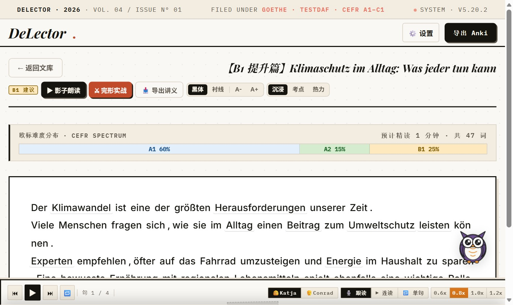

# DeLector · 德语欧标沉浸精读与考点剖析工作台

<p align="center">
  
  
  
  
  
  
  
  
</p>

<!-- Tests 徽章口径（可复算，非推算）：master@dd8036e（2026-11-06，CI run 42155129738）。
     分子 = 7 个 pytest 分片日志中 "N passed" 之和：678 + 681 + 348 + 712 + 316 + 19 + 25 = 2779；
     分母 = `python -m pytest tests --collect-only -q` = 2794 collected，差集 15 skipped
     （设计性 GUI / 桌面会话用例，逐条见各分片日志）。
     环境：Windows 11 / Python 3.11（.venv）。换提交后两条命令都需重跑，不得沿用旧数。 -->

<p align="center">
  <b>专为德语学习者与歌德（A1–C1）/ 德福（TestDaF）/ DSH 备考打造的学术级伴读与句法剖析系统。</b><br/>
  一键拆解<b>拓扑五场域（VF/LK/MF/RK/NF）</b>与 <b>AST 从句语法树</b>，内置<b>歌德 A1 全真考场</b>与 <b>FSRS 记忆排程</b>。
</p>

<p align="center">
  
  
</p>

---

## 快速启动

> **普通用户（免装 Python，开箱即用）**：
> - 🪟 **Windows**：前往下方 [多平台下载](#多平台下载发布包) 取得 ZIP，解压后双击 `DeLector.exe` 即可运行独立桌面客户端（无需配环境，数据保存在本地用户目录）。
> - 📱 **Android**：下载 APK 安装包，内嵌 Python 与 spaCy 离线模型，单机脱网可用。

**开发者 / 源码运行**：

```bash
uv venv --python 3.11                    # 创建项目级 .venv（依赖不再装进全局解释器）
uv pip install -r requirements.lock.txt  # 按锁定清单安装依赖（含桌面壳依赖）
uv run --no-project python -m spacy download de_core_news_sm  # 德语 NLP 模型（唯一档位；缺省自动下载 sm）
uv run --no-project python start.py      # 一键启动并自动打开浏览器 http://localhost:8000
uv run --no-project python desktop.py    # Windows 桌面壳（原生窗口 + 托盘 + 启动 splash）
docker compose up -d --build             # 或 Docker 容器化一键部署
```

> 开发者首次启用提交前密钥扫描（每个克隆都要做一次）：`git config core.hooksPath .githooks`
>
> 📖 Windows 分支 / Docker 细节 / 环境变量 / 打包 / 安全守卫等完整说明见 [docs/agents/ops.md](docs/agents/ops.md)。

---

## 多平台下载发布包

> 🚀 **v5.21.1 最新版本亮点（2026-11-03）**：
> - **伴学 SSE 跨 chunk 分帧修复**：修复网络分片导致的 assistant 消息与 proposal 静默丢失、不落库问题，完整帧闭合后才解析。
> - **传输与持久化守恒**：覆盖逐字节、随机分片、CRLF 与多行 `data`；原始字节转发不变，每轮只落库一次，proposal 不丢不重。
> - **内部重构行为不变**：Go helper 全面接线并拆分 `RunLoop`，`submitPrompt` 收敛为事件控制器；七类事件、请求字段与 DOM/消息状态保持既有契约。
> - **探针与变异验证**：伴学探针最终 274 checks / 34 场景，本分支全量 2720 passed / 2 skipped；Go 与 JS 变异均实测变红，还原后复绿。

> 📱 **Android 用户注意**：含 `static/` 改动的版本需**覆盖安装**才生效。
> 📜 完整版本变更细节见 [CHANGELOG.md](CHANGELOG.md)。

| 平台               | 版本                   | 说明                                                                                                                                                                                                                                                       | 下载通道                                                                                    |
| ------------------ | ---------------------- | ---------------------------------------------------------------------------------------------------------------------------------------------------------------------------------------------------------------------------------------------------------- | ------------------------------------------------------------------------------------------- |
| 🪟 **Windows x64** | `v5.21.1` | 原生桌面窗口 + 系统托盘，免装 Python，解压双击 `DeLector.exe`；**需 Win10+ 与 WebView2 运行时**（Win11 自带；Win10 装不上时的表现见「已知限制」）；首次启动把数据放到 `%LOCALAPPDATA%\DeLector`                                                                                                                                                                        | [下载 ZIP 包 (GitHub Releases)](https://github.com/ROM4n2/DeLector/releases/tag/v5.21.1)     |
| 🍎 **macOS**       | `v5.21.1` | 解压运行 `start` 脚本，全自动启动服务与默认浏览器                                                                                                                                                                                   | [下载 TAR.GZ 包 (GitHub Releases)](https://github.com/ROM4n2/DeLector/releases/tag/v5.21.1)  |
| 🐧 **Linux x64**   | `v5.21.1` | 全发行版通用，解压运行 `start` 即可使用                                                                                                                                                                                             | [下载 TAR.GZ 包 (GitHub Releases)](https://github.com/ROM4n2/DeLector/releases/tag/v5.21.1)  |
| 📱 **Android**     | `v5.21.1` | 内嵌 Python 运行时与 spaCy 离线模型，单机独立运行；**支持 arm64-v8a**，CI 钉死签名 keystore 并验签（可覆盖升级）。 | [下载 APK 安装包 (GitHub Releases)](https://github.com/ROM4n2/DeLector/releases/tag/v5.21.1) |

---

## 文档导航

| 需要什么 | 去哪 |
| --- | --- |
| 项目状态 / 红线 / 待办 | `WORKMEMORY/PROJECT_OVERVIEW.md` |
| AI Agent 入口（纯路由） | `AGENTS.md` |
| 产品特性全览 | `FEATURES.md` |
| 架构细节（技术栈 / NLP / DB / API / 前端拓扑） | `docs/agents/architecture.md` |
| 安全守卫 / 本机环境 / 打包 / 工作惯例 | `docs/agents/ops.md` |
| 设计系统 / 视觉 Token / 组件蓝图 | `docs/design-system.md`（token 现值以 `static/css/tokens.css` 为准） |
| 设计与实施计划 | `docs/specs/`、`docs/plans/` |
| 版本历史 | `CHANGELOG.md` |
| 贡献指南 | `CONTRIBUTING.md` |
| 行为准则 | `CODE_OF_CONDUCT.md` |
| 安全策略 | `SECURITY.md` |
| 架构决策记录（ADR） | `docs/adr/` |

---

## 核心特性

- **德语精读工作台**：CEFR 词阶热力图 + 0ms 歌德离线词库 + 荧光便签、AI 导读与打印级《精读指南》导出。
- **句法拓扑与 AST**：经典五场域（VF/LK/MF/RK/NF）色谱条切分 + 5 大从句抽象语法树 + 一键制 Anki 语法卡。
- **FSRS 卡盒与背词工作台**：3D 拟真翻牌 + FSRS 现代自适应排程（消解 Ease Hell）；A1/A2/B1 多档背词台（`VOKABELN`）与介词矩阵视图。
- **备考域 A1–B1**：歌德全真听说读写考场工坊（写作 / 听力 / 阅读 / 口语 / 词表）+ 德福 C-Test + 听力微训 / 长难句精读工坊。
- **遇见区分级阅读**：i+1 阅读桥 + 逐词注解 + 生词一键进卡，配套桌面→手机局域网 P2P 静默同步。
- **内联 IDE 写作工坊 & 伴读宠物**：行内实时语法诊断 + VSCode 级 Inlay Hints；Eule & 伙伴混合双模伴读。

> 完整功能清单见 [FEATURES.md](FEATURES.md)。

### 工程取舍（每条都有可点击出处）

- **列表成本量到毫秒**：文章列表 **918 ms → 8.9 ms（约 103×）**；同批修复还包括首屏少 **383.4 KB**。出处：[ADR-0022](docs/adr/2026-10-11-adr-0022-release-gate-v5.17.0.md)。
- **CI 只删重复、不删检查**：Ruff/mypy 从六个分片各跑一次收敛为只在 `unit-2` 跑，静态检查累计 **92 s → 14 s（-78 s runner 时间）**；墙钟未因此下降，所以不拿它宣传「变快」。出处：[CI 速度预算 §1.3](docs/agents/ci-speed-budget.md)。
- **分片必须真互斥**：旧写法 `glob + --ignore` 对显式文件无效，一次 run **重复执行 356 个用例**；改为 `tools/ci_shards.py` 显式清单后，本地六分片 **2749 passed / 4 skipped**（2026-11-04 基线，当前总数见顶部徽章），并新增 4 条守卫。出处：[CI 速度预算 §1.4](docs/agents/ci-speed-budget.md)。
- **模型档位用数据定**：111 句真实语料里 md 仅 **3/111（≈2.7%）** 句判定更合理，体积却是 sm 的 **2.82×**（21.16 → 59.61 MB），因此只保留 sm。出处：[ADR-0027](docs/adr/2026-11-04-adr-0027-nlp-model-sm-only.md)。
- **发版可验证**：Android 正式包只出 **arm64-v8a**，发布前用 `keytool` 校验 APK 与 keystore 的 **SHA256 证书指纹**一致，不一致即阻断。出处：[build-release.yml](.github/workflows/build-release.yml)。

> 💬 **用着顺手或别扭，都欢迎说一声**：[开一条零门槛反馈](https://github.com/ROM4n2/DeLector/issues/new?template=feedback.md)——**不用懂技术、不用建分支、不用写 `bug(scope):` 前缀**，三道判断题点一下就行，想吐槽什么随手写（留空也完全 OK）。你的反馈直接决定下一个版本做什么。

---

## 技术栈架构

| 领域             | 核心技术                                   | 说明                                                                                |
| :--------------- | :----------------------------------------- | :---------------------------------------------------------------------------------- |
| **后端框架**     | `FastAPI` + `Uvicorn`                      | 异步高性能 REST API                                                                 |
| **自然语言处理** | `spaCy` (`de_core_news_sm`)                | 本地高精德语分词、词性标注、形态分析与五场域句法依存                                |
| **形态学引擎**   | `delector/nlp_engine/linguistics.py`                  | 556+ 不规则动词三态表 + 复合词动态规划递归拆解                                      |
| **拓扑句法树**   | `delector/nlp_engine/syntax_tree.py`                  | Vorfeld/LK/MF/RK/NF 五场域切分 + 5 大从句 AST 抽象语法树                            |
| **持久化存储**   | `SQLite 3` (`delector.db` + `progress.db`) | 核心文库与时序台账双库解耦存储                                                      |
| **语音合成**     | `Edge-TTS` (Microsoft Neural Voice)        | 神经级纯正德语离线本地缓存与 Web Speech 回退                                        |
| **前端架构**     | `ES Modules / Modern CSS / Vanilla JS`     | 零 Node 构建依赖、模块化架构、原生 3D CSS 渲染                                      |
| **记忆同步**     | `genanki`                                  | 离线生成标准 `.apkg` 记忆库                                                         |
| **自动化测试**   | `pytest` + `httpx`                         | 7 路 pytest 分片（unit-1..4 / integration-heavy / cost-guards / cost-cold-start）跑全量用例；静态、分层、契约、密钥扫描闸 + Go race + Windows 便携包冒烟；Android 构建并校验签名指纹（NLP 只装 `de_core_news_sm`，md 路径已按 ADR-0027 删除） |

---

## 数据目录与旧版迁移（桌面端 / Docker 均必读）

**桌面端默认把数据放在用户目录、不随程序目录**：Windows 为 `%LOCALAPPDATA%\DeLector`，
macOS / Linux 为 `~/.local/share/DeLector`；文件是 `delector.db` 与 `progress.db`。两个开关：

- `DELECTOR_PORTABLE=1` ⇒ 数据回到程序目录（U 盘 / 多机场景）；
- `DELECTOR_DATA_DIR=<目录>` ⇒ 显式指定落点（优先级最高）。

**首次从「数据随程序目录」的旧版升级**时会自动搬一次：新位置复制成功后，旧文件改名为
`delector.db.bak-<时间戳>`（**永不删除**，确认无误后可自行清理）。

**Docker 部署的数据落在 `./data` 目录**（`DELECTOR_DATA_DIR=/app/data`）。挂目录而非单文件，
是因为 WAL 会在库旁生成 `-wal`/`-shm`，单文件挂载会在 `docker compose down` 后丢尾写。

⚠️ **从旧版单文件挂载（`./delector.db:/app/delector.db`）升级的用户**：直接
`docker compose up -d --build` 会得到一个**功能正常但数据全空**的应用——旧库还在仓库根，
而容器现在去读 `./data`。**数据文件没有被删除**，只差一次复制：

```bash
mkdir -p data && cp delector.db data/delector.db   # progress.db 同理
```

为杜绝「静默空库」（空库一旦建出，用户的诊断直觉是「数据丢了」，进而可能做不可逆的
恢复出厂操作），应用启动时会自检：**新位置无库 + 旧位置有非空库 ⇒ 拒绝启动**，并在日志里
打印两个绝对路径和一条可直接复制的 `cp` 命令。照做后重启即可。（日志里的 `cp` 给的是
**容器内**路径，要在容器里执行，或用 `docker compose cp`。）

同一条迁移规则对**桌面端手工设 `DELECTOR_DATA_DIR`** 同样适用：把 `DELECTOR_DATA_DIR`
指向一个新目录、而旧位置的 `delector.db` 还在仓库根时，闸会以同样理由拒绝启动，直到你把
库复制到新目录为止。

---

## 目录结构

```
DeLector/
├── delector/          # 后端核心包：server.py + core/(DB·安全·版本) + nlp_engine/(spaCy·拓扑·AST) + routes/(领域路由) + services/(LLM·TTS) + tools/ + data/
├── static/            # 前端零构建体系：index.html + layout/ + views/ + modals/ + js/(42 模块) + german/(工作台) + css/(视觉 tokens)
├── android/           # Android 独立离线单机版工程 (Chaquopy + Gradle)
├── agent/             # Phase 2 Go Agent Runtime（CLI + DAG + 工具注册，预览通道）
├── tests/             # 自动化测试套件：180 个 test_*.py（2,794 collected / 2,779 CI passed） + 行为探针与迁移哨兵
├── tools/             # 架构守卫工具链：六道机械闸 (分层契约/层序/Mock漂移/禁止静默降级/API契约/HTML同步) + 构建装配工具
├── docs/              # 仓库文档中枢：agents/(架构·运维) · specs/(设计) · plans/archive/(已归档计划) · adr/ · reviews/
├── WORKMEMORY/        # 共享工作记忆系统：PROJECT_OVERVIEW.md · work.log · PROTOCOL.md
├── start.py           # 跨平台智能启动脚本（Android 回环 / 桌面 0.0.0.0）
├── desktop.py         # Windows 原生桌面壳（pywebview + 托盘 + splash）
├── package_windows.py # Windows 绿色免安装便携版打包脚本
├── Dockerfile         # 容器化构建
├── docker-compose.yml # Compose 编排
└── requirements.txt   # Python 依赖清单
```

> 📖 逐目录 / 逐模块详情（含 js 模块清单、后端子包分层）见 [docs/agents/architecture.md](docs/agents/architecture.md)。

---

## 版本历史

本项目遵循语义化版本规范。完整版本历史、发版演进与回滚方案见 **[CHANGELOG.md](CHANGELOG.md)**。

| 版本 | 发布日期 | 里程碑概要 |
| :--- | :--- | :--- |
| **v5.21.1** | 2026-11-03 | 伴学 SSE 跨 chunk 分帧修复 · Go RunLoop 与 submitPrompt 行为不变重构 · 274 checks / 34 场景 |
| **v5.21.0** | 2026-11-03 | 伴学 Agent 页面级能力与 HITL 生词提议 · 跨页历史恢复 · 卡盒缺释义统一 · PWA 位图图标 · 桌宠眨眼原点修复 |
| **v5.20.2** | 2026-11-01 | 阅读器连续段落排版重塑 (ADR-0026) · CEFR 词阶视觉降噪与三档透视胶囊 · 单词点击/切句句法抽屉实时联动同步 (DFS-DEBUG) · CI 6 路并行矩阵极限提速 |
| **v5.20.1** | 2026-11-01 | Android 移动端桌宠拖拽手势修复 · 句法默认显示清除（收敛至选区悬浮胶囊工具条）· CI Pytest Matrix 双分片并发提速 · Apache License 2.0 正式生效 |
| **v5.20.0** | 2026-11-01 | 伴学导学 Agent 运行时（Go 编排 · 原生 Tool Calling · Pi 式动态 60% 压缩 · TurnPipeline 中间件 · 物理 trace）· SQLite 会话持久化与画像探针（FSRS 负荷 · 离线词典）· 前端纯 DOM 解耦 · 移动端抽屉上下拖拽可调尺寸与三档预设 · 2670+ passed |
| **v5.19.0** | 2026-10-22 | 桌面单实例锁（OS 文件锁判据，双击第二次不再起第二个进程）· 端口自动顺延 8000→8002–8010（8001 留给 supervisor）· `lan-info` 上报真实端口 · 前端 `reader.js`/`cards.js` 继续解耦（`rd-syntax`/`rd-api`/`cd-state`）· 2584 passed |
| **v5.18.0** | 2026-10-19 | 单体架构与前端视图全面解耦（database/routes 拆解 · index.html/writer.js/reader.js 模块化）· 交互式智能体循环（ADR-0023 / 裁判终审 / AI 润色）· 裁判集扩充与真题回测（ADR-0024）· 六道自动化机械闸矩阵落地 · 2438 passed（净增 670 用例） |
| **v5.17.0** | 2026-10-11 | 首个原生桌面壳（pywebview + 系统托盘 + 统一退出收尸）· 数据落点外置 `%LOCALAPPDATA%\DeLector` · 更新可见性（顶栏 chip + `/api/update/check`）· 发版门守卫（tag == `v`+`APP_VERSION`）· 真启产物闸 / 前端跨边界契约闸 · spaCy 惰性加载 |
| **v5.16.0** | 2026-10-06 | 惰性迁移性能缺陷根治（消除单篇 GET spaCy N+1 重算）· CI 必需运行时清单显式化 · localhost 守卫加固 |
| **v5.15.0** | 2026-10-05 | 降级标记并发串味修复 · 工作台单点化来源判据 · localhost 受保护路由集合与探针 `--json` 契约冻结守卫 |
| **v5.14.0** | 2026-10-05 | 卡盒去复习化（修复「白复习」P0）· 听力微训与长难句精读工坊 · 5 维难度评分与 CEFR 估算 |

> 📜 历史更多版本记录（v1.0 ~ v5.13）请回溯 [CHANGELOG.md](CHANGELOG.md)。

## 已知限制

- **Win10 需先装 WebView2 运行时**（Win11 自带）：缺运行时双击 `DeLector.exe` 会提示安装后退出，不会白屏。
- **冷启动的数字必须带「路径 × 冷/暖」两个标签**（同一个包能测出两个数，差 ≈0.67s）：**源码路径**（`python desktop.py`）暖 ≈ 5.4s / 冷 ≈ 6s；**便携产物**（你下载的 ZIP 里的 `DeLector.exe`）实测**冷 ≈ 8.5s / 暖 ≈ 6.9s**。其中约 2s 是「建服前的端口/身份校验」（防旧进程冒充新构建）——它是**新引入的显式校验，不是提速指标**；数据面已优化（文章列表 918ms → 8.9ms）。
- **`launch.log` 有已知的整行丢失**（Windows 上多个句柄并发追加同一文件，实测约 3% 的行整行消失、**不是半行**）：排查启动问题时若日志缺行，先按此排除；`tools/first_screen_from_log.py` 报退出码 3/5（缺锚行）**不必然**等于日志损坏。
- **Android 覆盖安装才生效**：含 `static/` 改动的版本必须覆盖安装（应用按 `versionCode` 判定重解包）。
- **Android 端「检查更新」暂未验证**：桌面端可用；Android 上两条假设（Chaquopy 能否完成到公网的 HTTPS、WebView 点外链是否交给系统浏览器）从未验证 ⇒ **手机上请以本页/Releases 的版本号为准**。
- **Android 装不回旧版**：`versionCode` 只升不降 ⇒ 装错版本只能卸载重装（会清应用私有数据，请先导出备份）。
- **Android 主路径已统一到 spaCy**：按 [ADR-0028](docs/adr/2026-11-06-adr-0028-android-main-path-spacy-lazy-load.md) 删除平台硬编码的纯 Python 降级；模型缺失/加载失败时句法专线**硬失败**，不返回近似结果。
- **存量文章按需惰性重算（3.6.0 起）**：`PROCESSED_JSON_VERSION` 3.5.0 → 3.6.0 后，升级前落库的旧结果（含 ADR-0028 之前在 Android 上用纯 Python 引擎算出的分词/句法）会在**首次打开该篇时**按需重算并回写；启动路径不扫全表、不批量重算。桌面实测典型文章约 20ms/篇，10 万字符上限级约 4–5s/篇；重算期间只有该篇的 GET 等待，其余文章不受影响。重算失败会**保留旧结果并返回 200**（日志 warning，响应带 `processed_upgrade_failed: true`），`raw_text` / 生词卡 / 批注从不被改动。覆盖前的旧结果快照在 `processed_json_backup`，可用 `python tools/recompute_processed.py --restore` 逐字回退（回退后需同时把版本号改回旧值，否则下次打开会再次重算）。
- **Android 首次加载耗时、内存峰值、低端机 OOM 均未测量**：测量任务未执行，这里不写「预计」或「约」。

---

## 许可证

本项目采用 [Apache License 2.0](LICENSE) 开源许可证。欢迎提 PR 或 Issue 参与共建！
