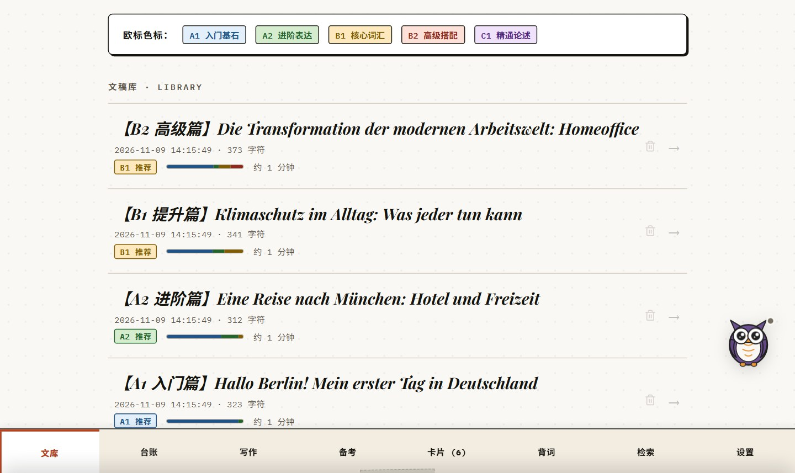
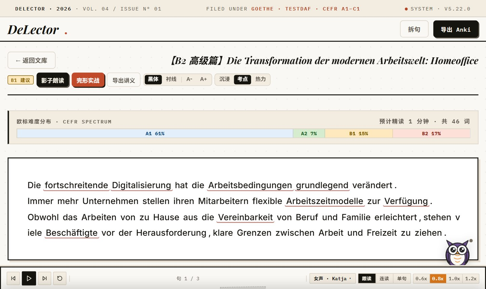

# DeLector · 德语欧标沉浸精读与考点剖析工作台

<p align="center">
  
  
  
  
  
  
  
  
</p>

<!-- Tests 徽章口径（可复算，非推算）：**v5.23.4 发布分支本地全量（2026-11-11）**；v5.23.5 **未复跑全量**（按 2026-11-13 起「只跑对点」的约束），故徽章沿用该时点数字，不得当作 v5.23.5 实测。
     分子 = `python -m pytest tests` 的 3040 passed；分母 = `--collect-only -q` 的 3054 collected
     （= 3040 passed + 8 skipped + 1 xfailed + 2 failed + 3 errors）。环境：Windows 11 / Python 3.11（项目级 .venv）。
     本机残留 5 条噪声，全部与本版改动无关（在未改动的 master 上同样失败）：
       - tests/test_frontend_layers.py::test_gate_cli_reports_file_line_rule_and_raw_line（GBK 控制台解码中文字面量）
       - tests/test_player_tray_probe.py::test_player_tray_probe_clean_run
       - tests/test_probe_json_contract.py 的 3 条（ERROR）
     CI（Linux）上全部通过，故分子按 passed 计、不把这些算成回归。
     本地 .venv 已按 `uv pip install -r requirements.lock.txt` 升到 fastapi 0.162.2 / click 8.5.1 /
     typer 0.28.0 / typing-inspection 0.4.5，因此该数字覆盖了新依赖。 -->

<p align="center">
  <b>专为德语学习者与歌德（A1–C1）/ 德福（TestDaF）/ DSH 备考打造的学术级伴读与句法剖析系统。</b><br/>
  一键拆解<b>拓扑五场域（VF/LK/MF/RK/NF）</b>与 <b>AST 从句语法树</b>，内置<b>歌德 A1 全真考场</b>与 <b>FSRS 记忆排程</b>。
</p>

<p align="center">
  
  
</p>

---

## 快速启动

> **普通用户（免装 Python，开箱即用）**：
> - **Windows**：前往下方[多平台下载](#多平台下载发布包)取得 ZIP，解压后双击 `DeLector.exe` 运行独立桌面客户端（无需配环境，数据保存在本地用户目录）。
> - **Android**：下载 APK 安装包，内嵌 Python 与 spaCy 离线模型，设计为单机脱网可用；真机覆盖安装与脱网运行尚未验证（见[已知限制](#已知限制)）。

**开发者 / 源码运行**：

```bash
uv venv --python 3.11                    # 创建项目级 .venv（依赖不再装进全局解释器）
uv pip install -r requirements.lock.txt  # 按锁定清单安装依赖（含桌面壳依赖）
uv run --no-project python -m spacy download de_core_news_sm  # 德语 NLP 模型（唯一档位；缺省自动下载 sm）
uv run --no-project python start.py      # 一键启动并自动打开浏览器 http://localhost:8000
uv run --no-project python desktop.py    # Windows 桌面壳（原生窗口 + 托盘 + 启动 splash）
docker compose up -d --build             # 或 Docker 容器化一键部署
```

> 开发者首次启用提交前密钥扫描（每个克隆都要做一次）：`git config core.hooksPath .githooks`
>
> Windows 分支 / Docker 细节 / 环境变量 / 打包 / 安全守卫等完整说明见 [docs/agents/ops.md](docs/agents/ops.md)。

---

## 多平台下载发布包

> **v5.23.5 最新版本亮点（2026-11-13）**：
> - **备份还原不再抹掉你刚存的东西**：还原失败的自动回滚过去会把间隙里其它请求写入的词卡 / 工作台状态一起覆盖。现在还原期间对所有请求置写屏障，新写入直接拒绝并提示稍后重试，回滚只影响还原自身。
> - **数据目录迁移不再静默丢学习记录**：旧版只看主库是否存在，`progress.db` 会被留在旧位置、新位置重建一个空进度库（台账 / 测验 / 模考记录全空）。现在逐库判定，缺库直接拒绝启动并打印拷贝命令。
> - **覆盖安装后不再跑旧前端资源**：Service Worker 只从当前缓存版本回落，不会把上一版的 JS 当成本版交付。
> - **Android 启动失败有终态**：预算耗尽后明确显示「已停止连接」并给出可点的「重试」按钮（旧版这行字点一次没反应，要点两下）。
> - **导出失败不再假成功**：写盘失败会清掉半截文件并提示错误，不再无条件报「已导出」。
> - **首屏演示卡不再报「本地引擎暂不可用」**：页面比本地服务早约 7 秒就绪，旧版把这段网络错误直接摊给用户（英文 `Failed to fetch`）且要手点重试；现在显示「正在启动」，服务就绪后自动补上。

> **Android 用户注意**：含 `static/` 改动的版本需**覆盖安装**才生效。
> 完整版本变更细节见 [CHANGELOG.md](CHANGELOG.md)。

| 平台               | 版本                   | 说明                                                                                                                                                                                                                                                       | 下载通道                                                                                    |
| ------------------ | ---------------------- | ---------------------------------------------------------------------------------------------------------------------------------------------------------------------------------------------------------------------------------------------------------- | ------------------------------------------------------------------------------------------- |
| **Windows x64** | `v5.23.5` | 原生桌面窗口 + 系统托盘，免装 Python，解压双击 `DeLector.exe`；需 Win10+ 与 WebView2 运行时（Win11 自带；Win10 缺运行时的表现见[已知限制](#已知限制)）；首次启动把数据放到 `%LOCALAPPDATA%\DeLector`；**自下一版起另提供安装版** `DeLector-v<版本>-Windows-x64-Setup.exe`（免管理员 per-user 安装、自带开始菜单与卸载器，支持 `/VERYSILENT` 静默安装；未做代码签名 ⇒ SmartScreen 可能提示「未知发布者」）                                                                                                                                                                        | [下载 ZIP 包 (GitHub Releases)](https://github.com/ROM4n2/DeLector/releases/tag/v5.23.5)     |
| **macOS**       | `v5.23.5` | 解压后进入 `DeLector-v5.23.5-macOS/`，运行其中的裸可执行文件 `./DeLector`（不是 `.app` 包）。正常 `tar -xzf` 解压会保留可执行位，若权限丢失先 `chmod +x DeLector`。包未做代码签名与公证，若被 Gatekeeper 拦截请右键「打开」，或在终端执行 `xattr -d com.apple.quarantine DeLector`。 | [下载 TAR.GZ 包 (GitHub Releases)](https://github.com/ROM4n2/DeLector/releases/tag/v5.23.5)  |
| **Linux x64**   | `v5.23.5` | 解压后进入 `DeLector-v5.23.5-Linux-x64/`，运行 `./DeLector`（正常 `tar -xzf` 解压会保留可执行位，若权限丢失先 `chmod +x DeLector`）。包在 CI 的 Ubuntu 环境构建，未在其他发行版验证。 | [下载 TAR.GZ 包 (GitHub Releases)](https://github.com/ROM4n2/DeLector/releases/tag/v5.23.5)  |
| **Android**     | `v5.23.5` | 内嵌 Python 运行时与 spaCy 离线模型，单机独立运行；正式包只出 **arm64-v8a**，CI 用 `keytool` 校验 APK 与 keystore 的 SHA256 证书指纹一致。**arm64 真机已做覆盖安装验证**（Redmi Note 8 / Android 11，v5.23.4→v5.23.5，2026-11-13）；阅读页未在真机点开（Android 侧文本导入受 `_require_localhost` 限制，空库设备没有可读文章，属设计）。 | [下载 APK 安装包 (GitHub Releases)](https://github.com/ROM4n2/DeLector/releases/tag/v5.23.5) |

---

## 文档导航

| 需要什么 | 去哪 |
| --- | --- |
| 项目状态 / 红线 / 待办 | `WORKMEMORY/PROJECT_OVERVIEW.md` |
| AI Agent 入口（纯路由） | `AGENTS.md` |
| 产品特性全览 | `FEATURES.md` |
| 架构细节（技术栈 / NLP / DB / API / 前端拓扑） | `docs/agents/architecture.md` |
| 安全守卫 / 本机环境 / 打包 / 工作惯例 | `docs/agents/ops.md` |
| 设计系统 / 视觉 Token / 组件蓝图 | `docs/design-system.md`（token 现值以 `static/css/tokens.css` 为准） |
| 设计与实施计划 | `docs/specs/`、`docs/plans/` |
| 版本历史 | `CHANGELOG.md` |
| 贡献指南 | `CONTRIBUTING.md` |
| 行为准则 | `CODE_OF_CONDUCT.md` |
| 安全策略 | `SECURITY.md` |
| 架构决策记录（ADR） | `docs/adr/` |

---

## 核心特性

- **德语精读工作台**：CEFR 词阶热力图 + 歌德离线词库 + 荧光便签、AI 导读与打印级《精读指南》导出。
- **句法拓扑与 AST**：经典五场域（VF/LK/MF/RK/NF）色谱条切分 + 5 大从句抽象语法树 + 一键制 Anki 语法卡。
- **FSRS 卡盒与背词工作台**：3D 拟真翻牌 + FSRS 现代自适应排程（消解 Ease Hell）；A1/A2/B1 多档背词台（`VOKABELN`）与介词矩阵视图。
- **备考域 A1–B1**：歌德全真听说读写考场工坊（写作 / 听力 / 阅读 / 口语 / 词表）+ 德福 C-Test + 听力微训 / 长难句精读工坊。
- **遇见区分级阅读**：i+1 阅读桥 + 逐词注解 + 生词一键进卡，配套桌面→手机局域网 P2P 同步（WebRTC Stage B；真机双端尚未验证）。
- **内联 IDE 写作工坊与伴读宠物**：行内实时语法诊断 + VSCode 级 Inlay Hints；Eule 与伙伴混合双模伴读。

> 完整功能清单见 [FEATURES.md](FEATURES.md)。

### 工程取舍（每条都有可点击出处）

- **列表成本量到毫秒**：文章列表 **918 ms → 8.9 ms（约 103×）**；同批修复还包括首屏少 **383.4 KB**。出处：[ADR-0022](docs/adr/2026-10-11-adr-0022-release-gate-v5.17.0.md)。
- **CI 只删重复、不删检查**：Ruff/mypy 从六个分片各跑一次收敛为只在 `unit-2` 跑，静态检查累计 **92 s → 14 s（-78 s runner 时间）**；墙钟未因此下降，所以不拿它宣传「变快」。出处：[CI 速度预算 1.3](docs/agents/ci-speed-budget.md)。
- **分片必须真互斥**：旧写法 `glob + --ignore` 对显式文件无效，一次 run 重复执行 356 个用例；改为 `tools/ci_shards.py` 显式清单后，2026-11-04 本地六分片基线为 **2749 passed / 4 skipped**（当前总数见顶部徽章），并新增 4 条守卫。出处：[CI 速度预算 1.4](docs/agents/ci-speed-budget.md)。
- **模型档位用数据定**：111 句真实语料里 md 仅 **3/111（约 2.7%）** 句判定更合理，体积却是 sm 的 **2.82×**（21.16 → 59.61 MB），因此只保留 sm。出处：[ADR-0027](docs/adr/2026-11-04-adr-0027-nlp-model-sm-only.md)。
- **发版可验证**：Android 正式包只出 **arm64-v8a**，发布前用 `keytool` 校验 APK 与 keystore 的 **SHA256 证书指纹**一致，不一致即阻断。该指纹校验只在 CI 执行，未在真机上复验。出处：[build-release.yml](.github/workflows/build-release.yml)。

> **用着顺手或别扭，都欢迎说一声**：[开一条零门槛反馈](https://github.com/ROM4n2/DeLector/issues/new?template=feedback.md)——不用懂技术、不用建分支、不用写 `bug(scope):` 前缀，三道判断题点一下就行，想吐槽什么随手写（留空也完全 OK）。你的反馈直接决定下一个版本做什么。

---

## 技术栈架构

| 领域             | 核心技术                                   | 说明                                                                                |
| :--------------- | :----------------------------------------- | :---------------------------------------------------------------------------------- |
| **后端框架**     | `FastAPI` + `Uvicorn`                      | 异步高性能 REST API                                                                 |
| **自然语言处理** | `spaCy` (`de_core_news_sm`)                | 本地德语分词、词性标注、形态分析与五场域句法依存（唯一档位，ADR-0027）               |
| **形态学引擎**   | `delector/nlp_engine/linguistics.py`       | 556+ 不规则动词三态表 + 复合词动态规划递归拆解                                      |
| **拓扑句法树**   | `delector/nlp_engine/syntax_tree.py`       | Vorfeld/LK/MF/RK/NF 五场域切分 + 5 大从句 AST 抽象语法树                            |
| **持久化存储**   | `SQLite 3` (`delector.db` + `progress.db`) | 核心文库与时序台账双库解耦存储                                                      |
| **语音合成**     | `Edge-TTS` (Microsoft Neural Voice)        | 在线神经语音合成 + 本地缓存；不可用时回落 Web Speech                                |
| **前端架构**     | `ES Modules / Modern CSS / Vanilla JS`     | 零 Node 构建依赖、模块化架构、原生 3D CSS 渲染                                      |
| **记忆同步**     | `genanki`                                  | 离线生成标准 `.apkg` 记忆库                                                         |
| **自动化测试**   | `pytest` + `httpx`                         | 7 路 pytest 分片（unit-1..4 / integration-heavy / cost-guards / cost-cold-start）跑全量用例；Ruff、mypy、前端契约、模板/样式同步、分层不变量、gitleaks 密钥扫描、Go 格式化/vet/race、Windows 便携包冒烟组成 CI 闸门；Android 构建与签名指纹校验在发布链路执行（NLP 只装 `de_core_news_sm`） |

---

## 数据目录与旧版迁移（桌面端 / Docker 均必读）

**桌面端默认把数据放在用户目录、不随程序目录**：Windows 为 `%LOCALAPPDATA%\DeLector`，
macOS / Linux 为 `~/.local/share/DeLector`；文件是 `delector.db` 与 `progress.db`。两个开关：

- `DELECTOR_PORTABLE=1` ⇒ 数据回到程序目录（U 盘 / 多机场景）；
- `DELECTOR_DATA_DIR=<目录>` ⇒ 显式指定落点（优先级最高）。

**首次从「数据随程序目录」的旧版升级**时会自动搬一次：新位置复制成功后，旧文件改名为
`delector.db.bak-<时间戳>`（永不删除，确认无误后可自行清理）。

**Docker 部署的数据落在 `./data` 目录**（`DELECTOR_DATA_DIR=/app/data`）。挂目录而非单文件，
是因为 WAL 会在库旁生成 `-wal`/`-shm`，单文件挂载会在 `docker compose down` 后丢尾写。

**从旧版单文件挂载（`./delector.db:/app/delector.db`）升级的用户**：直接
`docker compose up -d --build` 会得到一个**功能正常但数据全空**的应用——旧库还在仓库根，
而容器现在去读 `./data`。**数据文件没有被删除**，只差一次复制：

```bash
mkdir -p data && cp delector.db data/delector.db   # progress.db 同理
```

为杜绝「静默空库」（空库一旦建出，用户的诊断直觉是「数据丢了」，进而可能做不可逆的
恢复出厂操作），应用启动时会自检：**新位置无库 + 旧位置有非空库 ⇒ 拒绝启动**，并在日志里
打印两个绝对路径和一条可直接复制的 `cp` 命令。照做后重启即可。（日志里的 `cp` 给的是
**容器内**路径，要在容器里执行，或用 `docker compose cp`。）

同一条迁移规则对**桌面端手工设 `DELECTOR_DATA_DIR`** 同样适用：把 `DELECTOR_DATA_DIR`
指向一个新目录、而旧位置的 `delector.db` 还在仓库根时，闸会以同样理由拒绝启动，直到你把
库复制到新目录为止。

---

## 目录结构

```
DeLector/
├── delector/          # 后端核心包：server.py + core/(DB·安全·版本) + nlp_engine/(spaCy·拓扑·AST) + routes/(领域路由) + services/(LLM·TTS) + tools/ + data/
├── static/            # 前端零构建体系：index.html + layout/ + views/ + modals/ + js/(47 模块) + css/(视觉 tokens)
├── android/           # Android 独立离线单机版工程 (Chaquopy + Gradle；device / emulator 两个 flavor)
├── agent/             # Go Agent Runtime（CLI + DAG + 工具注册）
├── tests/             # 自动化测试套件：194 个 test_*.py + 行为探针与迁移哨兵
├── tools/             # 架构与视觉守卫工具链（契约/分层/同步/静默降级/视觉/工作台闸）+ 构建装配工具
├── docs/              # 仓库文档中枢：agents/(架构·运维) · specs/(设计) · plans/archive/(已归档计划) · adr/ · reviews/
├── WORKMEMORY/        # 共享工作记忆系统：PROJECT_OVERVIEW.md · work.log · PROTOCOL.md
├── start.py           # 跨平台智能启动脚本（Android 回环 / 桌面 0.0.0.0）
├── desktop.py         # Windows 原生桌面壳（pywebview + 托盘 + splash）
├── package_windows.py # Windows 绿色免安装便携版打包脚本
├── Dockerfile         # 容器化构建
├── docker-compose.yml # Compose 编排
└── requirements.txt   # Python 依赖清单
```

> 逐目录 / 逐模块详情（含 js 模块清单、后端子包分层）见 [docs/agents/architecture.md](docs/agents/architecture.md)。

---

## 版本历史

本项目遵循语义化版本规范。完整版本历史、发版演进与回滚方案见 **[CHANGELOG.md](CHANGELOG.md)**。

| 版本 | 发布日期 | 里程碑概要 |
| :--- | :--- | :--- |
| **v5.23.5** | 2026-11-13 | 备份还原写屏障（防并发写入被回滚抹掉）· 数据目录迁移逐库判 `progress.db`（防静默空进度库）· SW 缓存不跨版本回落 · Android 启动失败终态与可点重试 · 写路径事务边界 · 判据族从字符串断言改为行为探针 |
| **v5.23.4** | 2026-11-11 | 桌面导出改为 Python 显式落盘（不再假成功）· 修复 requirements.lock.txt 不可解（numpy / pydantic-core 与 Python 3.11 冲突）· 依赖批量升级与 CI 缓存动作 v6 |
| **v5.23.3** | 2026-11-11 | 修复「点开文章无反应」（阅读页模板引用已删除变量）· 修复 Android 退出重进停在 Webpage not available（就绪后补载一次）· x86_64 模拟器实测通过 |

> 更早的版本（v5.14.0–v5.21.1 等）已完整迁入 [CHANGELOG.md](CHANGELOG.md)，本页只保留最近三版。

## 已知限制

- **Windows 安装版未做代码签名**（无证书预算）：SmartScreen 会提示「未知发布者」，需选「更多信息 → 仍要运行」；安装器内嵌 WebView2 bootstrapper，系统缺运行时且安装时具备管理员权限才会自动补装（否则应用首次启动会提示并给出官方下载入口）。安装版与便携版并存，学习数据同样在 `%LOCALAPPDATA%\DeLector`，**卸载不会删除它**。
- **Win10 需先装 WebView2 运行时**（Win11 自带）：缺运行时的表现为启动阶段报错退出（历史记录；本版未在 Win10 上复验具体提示文案）。
- **冷启动时间未在 v5.22.0 重测**：历史实测（v5.17 时代）源码路径暖启动约 5.4s、便携产物冷启动约 8.5s，其中约 2s 是建服前的端口/身份校验；当前版本的具体数字以本机实测为准，本页不沿用旧值。
- **`launch.log` 有已知的整行丢失**（Windows 上多个句柄并发追加同一文件，历史实测约 3% 的行整行消失、不是半行）：排查启动问题时若日志缺行，先按此排除；`tools/first_screen_from_log.py` 报退出码 3/5（缺锚行）不必然等于日志损坏。
- **Android 覆盖安装才生效**：含 `static/` 改动的版本必须覆盖安装（应用按 `versionCode` 判定重解包）。
- **Android 端「检查更新」暂未验证**：桌面端可用；Android 上两条假设（Chaquopy 能否完成到公网的 HTTPS、WebView 点外链是否交给系统浏览器）尚未在设备上验证，请以本页 / Releases 的版本号为准。
- **Android 装不回旧版**：`versionCode` 只升不降，装错版本只能卸载重装（会清应用私有数据，请先导出备份）。
- **Android 主路径已统一到 spaCy**：按 [ADR-0028](docs/adr/2026-11-06-adr-0028-android-main-path-spacy-lazy-load.md) 删除平台硬编码的纯 Python 降级；模型缺失/加载失败时句法专线硬失败，不返回近似结果。
- **存量文章按需惰性重算（3.6.0 起）**：升级前落库的旧结果会在**首次打开该篇时**按需重算并回写；启动路径不扫全表、不批量重算。重算在单篇 GET 内**同步**执行，10 万字符上限级文章约 4–5s，期间只有该篇请求等待。重算失败会保留旧结果并返回 200（日志 warning，响应带 `processed_upgrade_failed: true`），`raw_text` / 生词卡 / 批注从不被改动。旧结果快照在 `processed_json_backup`，可用 `python tools/recompute_processed.py --restore` 逐字回退。
- **生词卡重复卡只做部分修复**：写入侧已改为幂等 upsert（同词重复提交不再新增），但未建 UNIQUE 索引、存量重复未合并；读侧按「共 N 张」去重显示。存量合并要等真实重复统计后再定策略。
- **Android 真机、低端机与 iOS 均未覆盖**：本版仅完成 x86_64 模拟器（API 37）覆盖安装与 `versionCode` 检查，未启动点检；arm64 真机未安装点检，低端机内存峰值与 OOM 未测量，iOS Safari 键盘态未验证。真机与低端机不是发版前置，但不得把模拟器结果当作真机结论。

---

## 许可证

本项目采用 [Apache License 2.0](LICENSE) 开源许可证。欢迎提 PR 或 Issue 参与共建。
